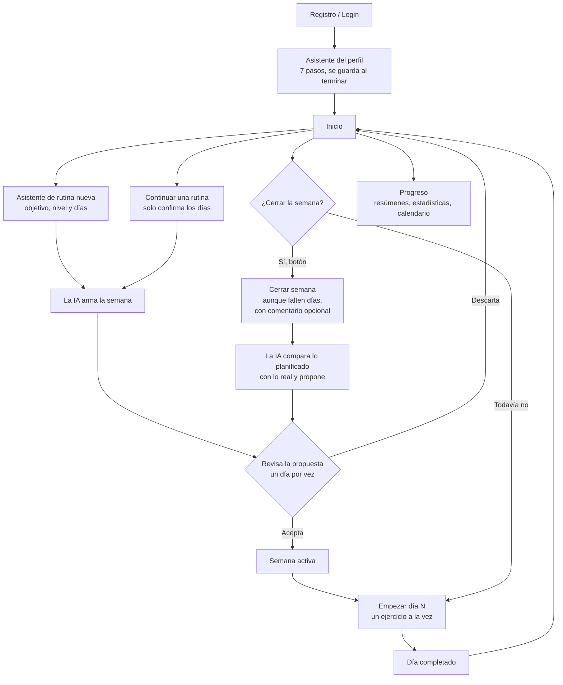

# Flujo de Spotter

Este documento describe cómo se usa la aplicación de principio a fin. Es la base para definir las pantallas, la API y el modelo de datos. Las decisiones de producto reflejadas acá las tomó el usuario; lo que se descartó figura marcado y los puntos abiertos están al final.

**Última revisión: 2026-10-15** (asistentes de una pregunta por pantalla, navegación con tres botones, Inicio con "Hoy te toca", Progreso con calendario, fecha de nacimiento).

## Resumen en pasos

1. La persona se **registra** y entra directo al asistente del perfil.
2. Completa su **perfil** en un asistente de una pregunta por pantalla (nombre, fecha de nacimiento, peso, altura, sexo, limitaciones y aviso legal).
3. Toca **"Generar rutina"**: en otro asistente elige, **cada vez que empieza una rutina nueva**, su objetivo, su nivel y cuántos días por semana (todo obligatorio), y la IA le arma la primera semana. No hay un camino para cargar una rutina propia (decisión 40).
4. Revisa la propuesta (un día por vez) y la **acepta o la descarta**. Al aceptar, la semana queda activa.
5. La semana se organiza en días: **Día 1, Día 2, Día 3**... La persona entrena a su ritmo: desde Inicio o Entrenar toca **"Empezar día N"** y avanza un ejercicio a la vez.
6. En cada día marca lo que hizo (o corrige lo realizado) y cierra con **"Día completado"**, que la lleva a Inicio.
7. Cuando ella decide, toca **"Cerrar semana"**: la IA compara lo planificado con lo real y propone la semana siguiente, que ella acepta o descarta.
8. Vuelve al paso 5. Puede ver cómo le fue en **Progreso** (resúmenes, estadísticas y calendario).

## Diagrama

## Objetivos

La persona elige uno **al empezar cada rutina** (no está en el perfil). Sin objetivo y nivel no se genera nada. Al continuar una rutina existente, la semana siguiente hereda los de esa rutina (quedan fijos).

| Objetivo | Qué prioriza la IA |
|---|---|
| Ganar masa muscular | Volumen moderado-alto, rangos de repeticiones medios, progresión gradual de carga |
| Ganar fuerza | Cargas altas con pocas repeticiones, ejercicios básicos, descansos largos |
| Perder grasa | **Más cardio y menos fuerza**: la fuerza se mantiene en el mínimo (al menos 2 días por semana) y el resto se completa con cardio. La alimentación queda fuera de la app |
| Mejorar condición física general | Rutinas equilibradas de cuerpo completo y variedad |
| Mantenerme activo | Rutinas simples y progresión suave |

Cada objetivo tiene su **ícono** (decisión 68) y cada nivel su dibujo de discos de pesas.

## El perfil

Se completa una sola vez, justo después de registrarse, y se edita después. El nivel y el objetivo no van acá: se eligen al empezar cada rutina. El equipamiento no se pregunta: se da por hecho un gimnasio completo.

### Asistente de creación (una pregunta por pantalla)

| Paso | Qué se pide | Cómo |
|---|---|---|
| 1 | Nombre | Campo de texto; viene el de la cuenta |
| 2 | **Fecha de nacimiento** | Tres ruedas (día, mes y año) y debajo "Tenés N años". La edad se **calcula** y es la que se muestra y la que recibe la IA. Entre 14 y 100 años |
| 3 | Peso | Regla horizontal, de a 0,1 kg (también − y +) |
| 4 | Altura | Regla vertical a la derecha, valor creciendo hacia arriba |
| 5 | Sexo | Tres opciones con dibujo; hay que elegir una |
| 6 | Lesiones o limitaciones | Texto libre, opcional ("Saltar") |
| 7 | Aviso legal | "Entiendo que la app no da consejo médico": hay que tildarlo |

- Cada paso tiene un botón **Continuar**, una flecha para volver y una barrita de avance.
- **El perfil se guarda en el servidor recién en el último paso** ("Terminar"). Mientras tanto, el avance queda como **borrador en el navegador** (por usuario, hasta 7 días): si se cierra la pestaña o se corta la conexión, se retoma en el mismo paso con lo que ya se había puesto. No guarda el tilde del aviso legal (se acepta de nuevo al final) y se borra al terminar. Es por dispositivo: en otro aparato se empieza de cero.
- Al terminar, lleva a Inicio.

### Ver y editar
El perfil muestra una **franja oscura** con el nombre y el correo, y tarjetas con los datos. Cada lápiz abre **solo los pasos de esa tarjeta**, con el dato actual ya puesto, y tiene **Cancelar**:

- Nombre → un paso.
- "Tu cuerpo" → fecha de nacimiento, peso, altura y sexo.
- "Lesiones o limitaciones" → un paso.

**Aviso legal:** la app no da consejo médico y hay que aceptarlo una vez. No se piden datos de salud más allá de lesiones o limitaciones. El Perfil tiene dos pestañas (decisión 75): **Perfil** (nombre, cuerpo, limitaciones) y **Cuenta** (correo, **Cambiar correo**, **Cambiar contraseña**, **Borrar cuenta** y **Cerrar sesión**). Esos tres botones y el **¿Olvidaste tu contraseña?** del login ya están, pero todavía no hacen nada: avisan "no está disponible" y llevan la etiqueta "Próximamente".

## Generar rutina

### El asistente
Se abre con **Generar rutina** (Inicio o Entrenar, sin semana activa) o con **Nueva rutina** (Inicio o Rutinas). Una pregunta por pantalla, con **Cancelar** arriba a la derecha en todos los pasos:

1. **Qué hacer** (solo si ya tiene rutinas): continuar una rutina existente o empezar una nueva.
2. **Objetivo** (rutina nueva): cinco opciones con su ícono.
3. **Nivel** (rutina nueva): principiante, intermedio o avanzado.
4. **Días por semana**: principiante **2 o 3** (R12) y el resto **de 2 a 6** (R11); las opciones que no corresponden aparecen apagadas. Va al final porque depende del nivel. Al continuar una rutina viene marcado el valor anterior y se puede cambiar (decisión 52).
5. **Generar**: la IA arma la semana. Continuar una rutina solo pide el paso de días.

**Si ya hay una semana en curso**, "Nueva rutina" no abre el asistente: avisa "Tenés una semana en curso. Para empezar una rutina nueva, primero cerrá la semana en curso desde Entrenar", con **Ir a Entrenar**. No se puede tener otra rutina en espera ni pausar la semana: se descartó (decisión del 2026-10-15). Para cambiar de rutina se cierra la semana, que se puede reabrir, y se empieza otra.

### Mientras la IA trabaja
La llamada a Gemini puede tardar de 10 a 90 segundos. Una **pantalla completa de carga** ("Armando tu semana") tapa todo, incluida la barra de abajo, y **no tiene botón de salir** (decisión 67): una sola generación a la vez por persona. Si pasa de 2 minutos, la app corta la espera y muestra un error. Cada llamada cuenta en el tope diario.

**Si algo sale mal** se ve un mensaje y se puede reintentar: falta el perfil o ya hay una semana activa o una generación en curso (409), llegó al tope por minuto o por día (429), la IA no respondió o no pudo armar una rutina válida tras un reintento (502), o la IA no está configurada (503).

### Cómo elige los ejercicios (catálogo con RAG, decisiones 58 y 67)

1. **Se eligen los candidatos:** el código descarta los de un nivel más alto y el cardio donde no corresponde; pgvector ordena por similitud y se toman hasta 6 por grupo muscular. Las lesiones no entran en la consulta (las razona la IA con el perfil).
2. **La IA arma la semana** con esa lista, y el código pone nombre y etiquetas del catálogo y rechaza lo que no esté (con un reintento).
3. **La propuesta se ve un día por vez.** Cada ejercicio desplegado tiene **Cambiar ejercicio**: alternativas del catálogo (mismo músculo y tipo, de tu nivel, que no estén en la semana); al elegir, se cambia en todos los días donde aparece, se copian series y repeticiones y el peso queda en blanco. Solo en la propuesta pendiente (decisión 65).
4. **Aceptar** muestra "Tu semana N ya está lista" con **Comenzar entrenamiento** y **Ver mi rutina**.

## La semana y los días

### La semana es un ciclo
La semana no está atada al calendario: empieza cuando la persona la activa y termina cuando la cierra con el botón. Si tarda más de siete días, sigue siendo la misma semana. Solo hay **una semana activa a la vez**; las anteriores se conservan como historial.

### Cuántos días tiene la semana
**Los elige la persona** (decisión 52, 2026-10-13; antes los decidía la IA): al generar, es obligatorio. La IA arma **exactamente** esa cantidad y el código lo comprueba (si no, reintenta). Como la IA ya no puede sumar días, si el volumen no entra alarga la sesión y avisa, y como último recurso recorta accesorios (R35). R1 (mínimo 2 días) y el máximo de 6 los valida el código.

### Duración de cada sesión
La IA decide cuánto dura cada sesión, con una **referencia según el perfil** (una guía, no un tope): principiante y "mantenerme activo" cerca de **60 minutos**; "condición general" **60**; intermedio con masa o fuerza **60 a 90**; "perder grasa" **60 minutos de fuerza más el cardio**.

### Días: "Día 1, Día 2"
Los días se nombran por orden y no por día de la semana (no hay "lunes" ni "martes"): el Día 1 puede ser cualquier día de la semana. Cada día tiene un título con su foco ("Día 1 · Pecho y tríceps"). La app sugiere el siguiente: el primer día que todavía no se completó.

## Dónde está cada cosa

### La barra de abajo
Fija, siempre, también en la computadora. Tiene **tres lugares**: **Inicio**, **Entrenar** (al centro, redondo y elevado) y **Perfil**. Rutinas y Progreso se abren desde Inicio, y mientras se está en ellos Inicio queda marcado.

### Inicio (`/`)
- **Franja oscura** con el logo, la fecha y "Hola, nombre".
- **"Hoy te toca":** la tarjeta principal. Con semana activa muestra la rutina, el número de semana, los discos de los días (el que toca hoy con aro azul), "N de M días", el próximo día con su duración y **Empezar día N**. Con todos los días completados invita a cerrar la semana. Sin semana activa muestra las opciones de Generar.
- **Aviso** de propuesta de la IA pendiente.
- **Tus rutinas:** "Tus rutinas" y "Nueva rutina" (abre el asistente o avisa).
- **Tu progreso:** "Resúmenes", "Estadísticas" y "Calendario". Las cinco tarjetas de acceso llevan el ícono y un texto corto en una sola línea.

### Entrenar (`/entrenar`)
La semana en curso: "Te toca Día N" con su botón, la lista de días con su estado y, al final, **Cerrar semana**. Sin semana activa ofrece generar o empezar una rutina nueva.

### Rutinas (`/rutinas`)
La lista de rutinas, de la más nueva a la más vieja (ícono, nombre, nivel, semanas, "en curso" o "lista para continuar" y los discos de la última semana). **Nueva rutina** es un botón redondo "+" flotante abajo a la derecha, sobre la barra de navegación (antes era una barra fija ancha; cambiado el 2026-10-16). De cada rutina se baja a sus semanas (línea de tiempo), a sus días y a los ejercicios.

**Desde Rutinas el día es solo para mirar** (decisión 53): no se registra, ni se cierra ni se reabre; se registra desde Entrenar o Inicio.

### Progreso (`/progreso`)
Tres pestañas:

| Pestaña | Qué muestra |
|---|---|
| **Resúmenes** | La semana elegida de una rutina: días y series hechas, kilos movidos y minutos de cardio; "Cómo te fue" (un disco por estado: superaste, cumpliste, no llegaste, sin registrar, con el detalle ejercicio por ejercicio plegado, donde cada ejercicio dice "Hiciste … / Tocaba …" cuando difiere de lo planificado); lo que dijo la IA y el comentario que se escribió al cerrar |
| **Estadísticas** | La evolución de un ejercicio por fecha, **acumulando todas las rutinas** (decisión 69), con el récord marcado |
| **Calendario** | Un mes en cuadrícula con un disco en cada día entrenado, hoy con aro azul; histórico, desde el primer entrenamiento. Tocar un día muestra qué se hizo |

## Entrenar un día

### El modo entrenar
"Empezar día N" abre una pantalla con **un ejercicio a la vez** y la serie actual en grande (decisión 46):

- **Entrada en calor:** si el día tiene movilidad, es el primer paso (decisión 56). No tiene series ni cuenta como ejercicio hecho.
- **Serie hecha:** guarda lo planificado; se corrige con el lápiz.
- **Reloj de descanso:** un botón redondo lo arranca, nunca solo, con el descanso del ejercicio; −15 s, +15 s y Saltar. Al llegar a cero vibra, y si se sale a otra pantalla una franja arriba de la barra lo muestra (decisión 48).
- Al terminar las series del ejercicio, lo marca y sigue con el próximo sin hacer; si se sale, retoma donde quedó. Flechas ‹ › para pasar de ejercicio.
- Al terminar los ejercicios aparece **Día completado**, que cierra el día y **lleva a Inicio**, donde ya figura lo que toca después.

### La lista del día
Además del modo entrenar, el día (`/semanas/{id}/dia/{n}`) se puede ver como lista: cada ejercicio es una tarjeta con el nombre grande, los números debajo y los discos del que está en curso; tocarla la despliega (una por vez) con las series, "Semana pasada", "Cómo hacerlo" y "Por qué está en tu rutina" (decisión 47). Hay barritas y flechas para pasar al día anterior o siguiente.

### Planificado vs. real
Cada día indica qué toca por ejercicio ("Toca press banca **3 × 8 con 50 kg**"). Se registra así:

| Lo que hace | Qué queda guardado |
|---|---|
| Marca el ejercicio sin cambiar nada | Cada serie con sus repeticiones y su peso planificados |
| Carga lo que realmente hizo (3 × 10 con 40 kg) | Lo que escribió, y el ejercicio queda hecho |
| No toca nada | El ejercicio queda como no hecho |

De la diferencia entre lo planificado y lo real salen el análisis y la semana siguiente.

### Series
- **Fila compacta:** si todas las series son iguales muestra "4 × 10 · 50 kg"; si difieren, un rango. Ese resumen se calcula, no se guarda.
- **Marcar una serie como hecha** (opcional) guarda lo planificado; **Desmarcar** borra lo registrado. **Editar** una serie (Guardar y Cancelar) registra lo realizado y deja la serie como hecha; el plan queda visible como referencia ("tocaba 8 × 55 kg").
- **Marcar un ejercicio como hecho** lo **cierra y lo bloquea**: las series sin registrar copian lo planificado y las editadas se respetan. **Reabrir ejercicio** lo desbloquea sin borrar nada; **Deshacer** borra lo registrado (con confirmación).
- **El plan no se edita a mano** (decisión del 2026-10-09). Lo único que la persona edita es lo realizado. La única excepción es **Cambiar ejercicio** en la propuesta pendiente (decisión 65).

### Descanso y movilidad
- **Descanso:** cada ejercicio trae el descanso entre series que propone la IA (`rest_seconds`).
- **Movilidad y equilibrio:** cada día puede traer un texto ("5 a 10 min de movilidad de cadera"); es una indicación, sin series.

### Cardio e isométricos
- **Cardio:** un ejercicio más, medido en **minutos** ("cinta · 30 min"). Sin cambios se toma como hecho tal cual.
- **Isométricos** (plancha): un ejercicio más, medido en **segundos** por serie. Cuenta como fuerza para los días y el volumen.

### Día completado
- Cierra la sesión (`workout_sessions.finished_at`). Los ejercicios sin registrar quedan como no hechos y se puede completar con pendientes.
- Con el día completado no se puede editar nada hasta tocar **Reabrir día** (en la lista del día).
- Los datos se guardan a medida que se cargan, no al terminar: si se corta la app no se pierde nada.
- Un día está **completo** cuando se tocó "Día completado" y **a medias** si solo hay algo registrado.

## La IA propone, la persona decide

Toda propuesta se guarda primero y se escribe en el plan **solo al aceptarla**, con vista previa.

### Cerrar la semana
El cierre es siempre **manual**, con un botón. Nunca se genera la semana siguiente por fecha.

1. Se toca **Cerrar semana** (al final de Entrenar). Puede hacerse aunque falten días: la app avisa cuáles faltan y esos días **cuentan como no hechos**. En el mismo recuadro hay un **comentario opcional** ("¿Cómo te sentiste esta semana?", hasta 1.000 caracteres): queda fijo y la IA lo lee.
2. Con **Generar la semana siguiente**, la IA recibe la última semana cerrada: por ejercicio, lo planificado y lo realizado serie por serie, y una **señal** que calcula el código (superó, cumplió, no llegó o sin registrar). Aplica R9, R10 y R28: si superó sube la carga de 2 % a 10 % partiendo del peso realmente levantado; si no llegó, mantiene; si hubo dolor, no sube. Mantiene los mismos ejercicios y escribe un **resumen** que se ve arriba de la vista previa. El código avisa si un peso sube más de 10 %.
3. La propuesta muestra **antes y después** (tarea #49): una etiqueta en cada ejercicio (↑ o ↓ antes X kg, antes 3 × 10, nuevo o sin cambios) y la pestaña "Cambios". Se acepta o se descarta.

Una llamada a la IA por cierre: el gasto es predecible.

### Reabrir una semana (decisión 66)
Desde la semana cerrada, con confirmación. Solo la última de su rutina, y no si hay otra semana en curso ni una propuesta sin revisar. Se borra el comentario de cierre; no se pierde lo registrado. Después de cerrar, **Entrenar** ofrece **Generar la semana siguiente** o **Empezar una rutina nueva**; **Inicio** ofrece solo **Generar la semana siguiente** (para una rutina nueva está la tarjeta "Nueva rutina" de más abajo).

### Descartado por ahora
- **Pausar la rutina activa o dejar otra en espera** (2026-10-15): innecesario. Se cierra la semana y se empieza otra; la anterior queda "lista para continuar".
- **Ajuste conversando durante la semana** (decisión 45, #29): el plan no cambia durante la semana y lo que no anda se cuenta al cerrarla.
- **Avisos al usuario** (decisión 63) y **ajuste de ejercicios repetidos** (decisión 64).
- **"Cómo me sentí" por día** (#46) y **semáforo de dolor** (#51): no se hacen por ahora (decisión 71). Cómo se sintió el entrenamiento y el dolor se cuentan en el **comentario al cerrar la semana**, que la IA lee. El **esfuerzo por serie** (#48) no se hace (decisión 74). El esfuerzo se deduce de comparar peso y repeticiones (decisión 73), y la **marca opcional de carga y dolor por ejercicio** (#63, decisión 74) está hecha: al terminar un ejercicio en el modo entrenar aparece "¿Cómo te fue?" (carga: Liviana, Bien, Pesada, Muy pesada; dolor: Leve, Moderado, Fuerte; las dos opcionales e independientes) y el botón "Siguiente ejercicio"; el resumen de Progreso la muestra. La semana liviana (R30) está descartada (decisión 72).

## Puntos abiertos

- **Comparar contra la semana pasada** en Progreso: hoy el resumen compara contra lo planificado (decisión del 2026-10-15); contra la semana anterior queda como mejora posible.
- **Recuperar y restablecer la contraseña.**
- **Encabezado de Inicio:** dónde van la fecha y el logo (el logo ya es el definitivo, decisión 76).

## Efectos sobre el modelo de datos

El detalle está en `docs/modelo-datos.md`. Cómo se refleja este flujo:

- `profiles`: `birth_date` (la edad se calcula; `age` se conserva para perfiles viejos), peso, altura, sexo y limitaciones. Sin nivel, objetivo ni equipamiento. **Migración 0018.**
- `routines`: nombre, objetivo, nivel y `days_per_week`; agrupan las semanas.
- `week_plans`: pertenece a una rutina; `week_start` es cuándo se activó, `closed_at` cuándo se cerró, y guarda el comentario de cierre y el resumen de la IA.
- `plan_days`: `day_index` es el orden (Día 1, Día 2...), no un día del calendario.
- `plan_exercises` y `plan_sets`: lo planificado (una fila por serie, con repeticiones o duración y peso).
- `set_entries`: lo real, enlazado a la serie planificada (`plan_set_id`). Una serie "hecha" tiene una fila acá.
- `workout_sessions`: una por día; `finished_at` es "Día completado" y es lo que usa el **calendario**.
- `exercise_completions`: los ejercicios cerrados con "Marcar como hecho".
- `plan_proposals`, `ai_calls` y `catalog_embeddings`: propuestas de la IA (`pending`, `accepted` o `discarded`), registro de cada llamada para los topes de Gemini y vectores del catálogo (pgvector).
- Endpoints de lectura para Progreso: `GET /weeks/{id}/summary`, `GET /exercises/{id}/history` y `GET /calendar?month=&tz=`.
